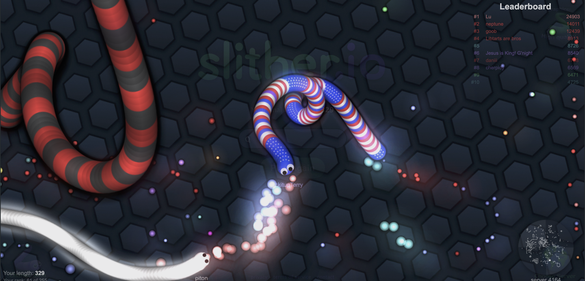
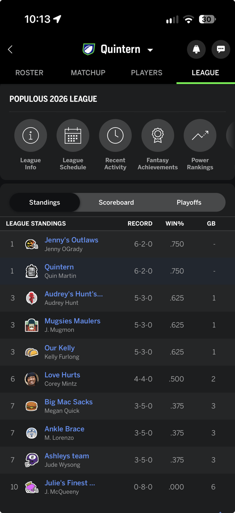
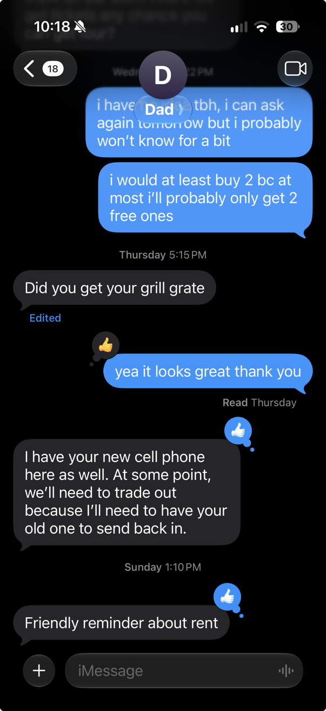

# Multiplayer log: Quin

Use three different multiplayer things (a game, a shared document, a chat, etc.)
and write down which design choices told you other people were there with you.
Bring this list to discuss on Wednesday, 2026-11-04.

| # | Thing | Type | When, with whom, how long | Design choices that told me other people were there | How it felt / what I noticed | Screenshot |
|---|---|---|---|---|---|---|
| 1 | **Slither.io** | Online game | 9:30 PM on 2026-11-03, with random players online, until I got tired of dying | Entering my name at the start, seeing other players' names, other snakes moving and using the same strategies as me, unique snake skins, and a small minimap showing where other players were. | It was glitchy (because of my computer), and it was super hard to work my way up the rankings. The few times I got a good run in made me want to keep playing after I lost. It was super colorful, vibrant, and fun to play and look at. |  |
| 2 | **ESPN Fantasy** | Fantasy league | All football season, with my Populous design team | Other players, player names and icons, a leaderboard, head-to-head matchups against another player, league chats, chats with individual players, and trades. | The app is pretty busy with a lot going on, but all the info is vital if you want to understand what's happening. It's important to stay on top of it every day so you can gain an advantage over the other league members and hopefully win each week. |  |
| 3 | **SMS (iMessage)** | Chat | Anytime, with my dad; usually a few seconds to type something out | His name and icon, his contact info, a live "…" bubble while he's typing, and reactions to messages. | Very clean, classic Apple design. It's easy to see when someone is responding or reacting to your messages, and it sends a notification whenever you get a message from that person. |  |

## Patterns across all three

-
