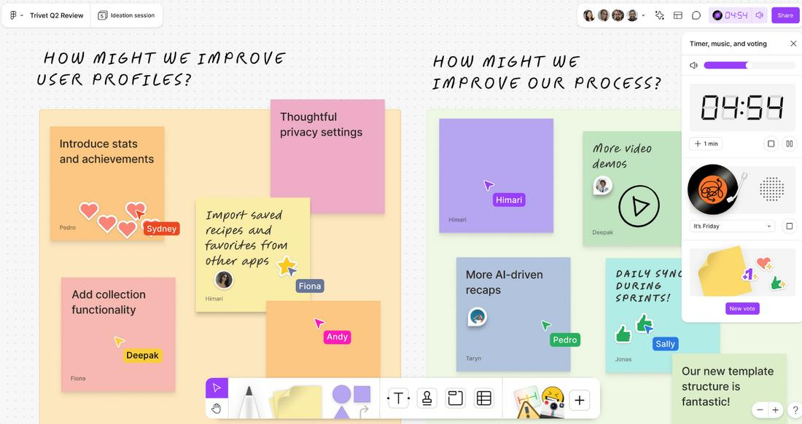
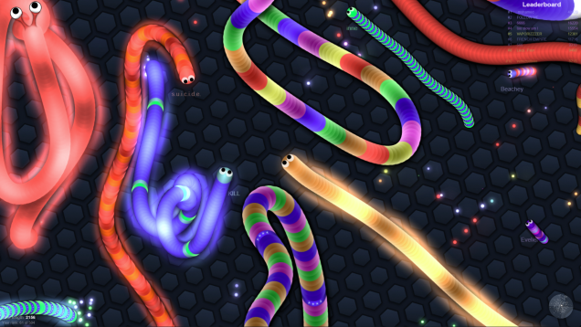
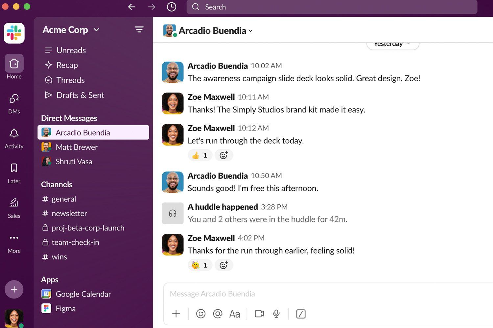

# Multiplayer log: Saj

Use three different multiplayer things (a game, a shared document, a chat, etc.)
and write down which design choices told you other people were there with you.
Bring this list to discuss on Wednesday, 2026-11-04.

| # | Thing | Type | Design choices that told me other people were there | Screenshot |
|---|---|---|---|---|
| 1 | **Figma** | Shared design file | Colored cursors with name labels showed me exactly where other people were working, and the avatars stacked in the top corner told me who was in the file. When someone selected or edited something, it appeared live in their color, so the file felt like a shared room and not a static document. |  |
| 2 | **Slither.io** | Online game | Name tags above each snake and a leaderboard ranking everyone by length made it clear that real people were playing alongside me. Other snakes reacted to my moves, circling me or cutting me off, and when one crashed it dropped glowing orbs I could eat. My actions affected other players, and theirs affected me, even though there's no chat. |  |
| 3 | **Slack** | Chat | Green presence dots next to names showed who was online, and the "someone is typing…" indicator told me a reply was on its way before it arrived. Every message carried an avatar, a name, and a timestamp, so I always knew who said what and when. Unread badges on channels also showed activity happening while I was away. |  |

## Patterns across all three

Each one gave other people an identity, through colors, avatars, name labels, or usernames, so I could tell who was there and not just that someone was. Each also showed activity as it happened, whether through moving cursors, snakes reacting to me, or a typing indicator, which made the space feel live. Finally, each gave a shared signal of presence, like stacked avatars in Figma, the leaderboard in Slither.io, or online dots in Slack, so I could tell at a glance who was around.

**The common idea:** multiplayer feels real when a design makes people visible, shows what they're doing right now, and lets their actions affect mine.
